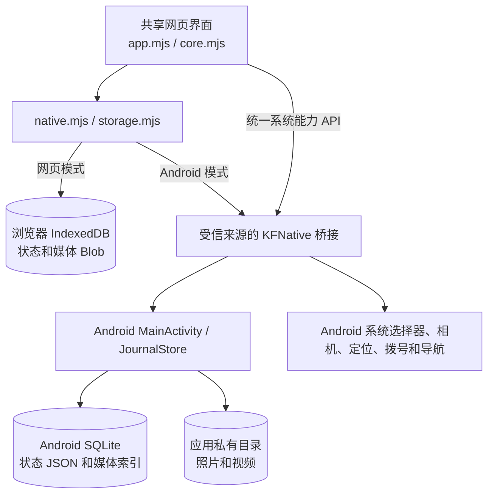

# 看房日记

个人使用、离线记录优先。包含已确认的手机网页原型，以及复用同一界面的安卓工程。配色采用蓝色主色、白色卡片、浅灰背景和橙红价格。

## 安卓首版

**[下载 Android 测试版 APK（0.1.5）](https://github.com/wang-ironman/KF-Note/raw/refs/heads/main/artifacts/%E7%9C%8B%E6%88%BF%E6%97%A5%E8%AE%B0-0.1.5-debug.apk)**（[仓库内文件](artifacts/看房日记-0.1.5-debug.apk)）。这是本地调试签名的体验版，最低 Android 8.0，页面需要 Android System WebView 100 或更新版本。将 APK 复制到手机，使用文件管理器打开，并按系统提示允许本次安装来源。更新体验版时应覆盖安装；卸载会删除本机数据。

安卓界面随安装包提供，无需电脑服务或联网。文字和结构化记录保存在 SQLite；原图复制到应用私有文件目录，列表生成缩略图，不依赖相册文件继续存在。相机和相册通过系统界面操作，定位只在主动点击时请求权限，拨号调起系统拨号盘。

房源卡片的封面、文字和空白处均可进入继续编辑，“对比”勾选独立操作。新建房源、房源基本信息和通勤目的地都可使用手机当前位置，确认后保存 GPS 坐标。已保存完整坐标时可手动打开高德导航，自动填入名称和目的地；高德未安装时显示提示。定位填写坐标，地址名称仍可手写。

“基本信息”包含小区配套、交通、生活配套的图文记录，可选择看房日期查看历史；“看房日记”包含总体感受、户型、整屋及各房间。原有小区和交通图文继续保留，生活配套也参与房源对比。

基本信息支持保存房源网址、分享口令或完整分享文本。首页卡片长按显示修改状态、复制房源与删除操作；右上角状态也可直接点击修改为待考虑、心仪或已排除，删除前确认关联日记和照片数量。复制保留基本信息、费用、联系人、空间、全部看房记录及照片，生成“（副本）”后直接进入编辑，不自动加入对比；修改或删除任一份记录不会影响另一份。

照片查看页使用已保存原图，提供放大、缩小、复位按钮，支持双指缩放、双击放大和拖动查看，最高放大到适配尺寸的 6 倍。缩放只影响查看方式，重新打开恢复适配大小，原图及照片说明保持不变。

各记录分区的“照片／视频”入口支持添加照片及 MP4、WebM、3GP 视频。视频保存到本机，支持离线播放、暂停、进度拖动和说明文字；复制房源及 ZIP 备份包含视频，删除一份不影响其他副本。视频不作为封面或户型图，实际播放能力取决于设备支持的编码，建议使用常见 H.264 编码的 MP4。安卓选择视频时以文件流保存，播放按需读取本地文件。

“现场拍视频”可直接调起安卓系统相机录像，确认录制后保存到当前房源、看房日期和分区；取消或空录像不创建记录。安卓以文件流暂存和提交录像，兼容相机直接写入指定文件和通过返回 URI 提供文件两种方式。网页端提供后置摄像头录像入口，是否直接打开相机由手机浏览器决定。

0.1.5 修复了部分 MP4 读取文件后段时播放失败的问题：应用向 WebView 提供从文件起点开始的完整流，由 WebView 对请求范围定位，避免重复跳过字节。已有视频无需重新添加；播放编码仍取决于设备解码能力。

房源详情顶部提供“生成房源介绍”，根据当前基本信息、费用、家具取暖、宠物约定、配套、各房间观察及通勤记录，在本机汇总为一段文字，可修改后复制。未知金额和条款仍标为待确认，现场观察与口述来源保留，不请求网络或人工智能服务。预览修改只用于本次复制；再次生成时以已保存的房源记录为准，不另存一份介绍。

中介费分别记录一次性中介费和每月服务费，分别计入一次性支出和月支出参考。固定费用选择免费自动显示他人承担；选择自费自动显示自己承担并要求补充金额，金额留空时仍为待补充。

设置中可通过系统文件选择器导出完整 ZIP，网页和安卓使用同一备份格式，可互相导入。导入为全量替换；照片及视频摘要、字段与引用校验全部通过、文件暂存完成后才提交数据库。取消导出不会更新备份时间。首版备份打包在内存中进行，大量高分辨率照片及视频可能受设备内存限制，建议及时备份。

本地构建需要 Node.js 与 PowerShell 7（工具仅安装在项目 `.tools` 目录，不改系统全局环境）：

```powershell
npm install
npm run android:setup
npm run android:build
```

工程位于 `android/`。页面打包脚本 `scripts/build-android-assets.mjs` 将 `prototype/` 的界面和本地依赖放入应用资源；Android Java 宿主提供 SQLite、照片文件、系统文件选择器及定位。仅本地资源可使用原生桥接，应用未声明互联网权限。

原生检查安装包可运行 `pwsh -NoProfile -File scripts/build-android.ps1 -TestApk` 构建，再通过 ADB 安装主包和 `android/app/build/outputs/apk/androidTest/debug/app-debug-androidTest.apk`，执行：

```powershell
adb shell am instrument -w com.kfnote.app.test/com.kfnote.app.StoreInstrumentationRunner
```

工具实际路径记录在 `.tools/android-env.json`。真实设备上的相机、相册、定位拒绝/授权、系统导入导出以及关闭应用再打开，仍应按 [安卓验收说明](docs/安卓首版验收.md) 检查。

安卓页面集成脚本为 `prototype/tests/android-ui.mjs`，通过 `ANDROID_CDP_URL` 指定已转发的 WebView 调试端口，通过 `PLAYWRIGHT_MODULE` 指定 Playwright 模块（需支持 `connectOverCDP` 的 `noDefaults`）。只在空数据的专用模拟器执行；它使用真实原生存储，系统图片与文件选择回调用样本模拟。本次 API 35 模拟器的原生测试、页面流程及强制停止后重开均通过，记录见 `artifacts/verification.json`。

## 技术栈

| 部分 | 实现 |
| --- | --- |
| 网页界面 | 原生 HTML、CSS 和 JavaScript ESM；esbuild 0.25.12 将入口打包为本地脚本，目标 WebView / Chromium 100 |
| 本地网页依赖 | JSZip 3.10.1 读写 ZIP；js-sha256 0.11.1 校验媒体摘要 |
| Android 工程 | Java 17，JDK 17+；Android Gradle Plugin 8.13.2；Gradle 8.13；Android SDK 36，`minSdk` 26、`targetSdk` 36 |
| Android 页面 | WebView 加载 APK 内打包的网页资源；与网页共用同一套业务界面代码 |
| 浏览器持久化 | IndexedDB 保存结构化状态和媒体 Blob，数据按浏览器源隔离 |
| Android 持久化 | 系统 SQLite 保存结构化状态与媒体索引，照片和视频放在应用私有文件目录 |
| 外部网络 | 网页侧互联网连接被 CSP 禁止；Android Manifest 未声明 `INTERNET` 权限，线上业务和云同步不属于当前实现 |

前端运行没有 React、Vue 等 UI 框架，也没有把照片上传到服务器。`jszip`、`js-sha256` 是运行时依赖，`esbuild` 只用于构建 APK 内的网页资源。

## 模块与依赖

网页与 Android 共用 `prototype/` 的数据模型和界面。`npm run android:assets` 从这份网页代码生成 APK 的静态资源，Android 宿主负责提供离线页面、原生持久化以及系统能力。

| 模块 | 职责 |
| --- | --- |
| `prototype/core.mjs` | 看房日记、房源、空间、费用和对比的数据结构、校验与纯计算规则 |
| `prototype/app.mjs` | 页面渲染与用户流程编排；将浏览器和 Android 的持久化、文件选择、定位等入口委托给适配层 |
| `prototype/storage.mjs` | 按运行环境使用 IndexedDB 或 Android 本地桥接；验证 JSON 和媒体，并生成、校验及恢复 ZIP 备份 |
| `prototype/native.mjs` | 识别 Android WebView，统一调用持久化与系统能力接口，并转换浏览器 Blob 与原生 Base64 数据 |
| `scripts/build-android-assets.mjs` | 用 esbuild 打包网页入口，将样式、图标和本地依赖复制进 APK 资源 |
| `MainActivity.java` | 创建 WebView，校验本地虚拟 HTTPS 来源，提供受信页面 JavaScript 桥接，并调用 Android 文件选择器、相机、定位、拨号及导航 |
| `JournalStore.java`、`JournalDatabase.java` | SQLite 状态及媒体索引、应用私有媒体文件、缩略图、ZIP 导入暂存与媒体请求响应 |
| `PhotoProvider.java` | 通过短期 `content://` URI，让系统相机把新拍照片或视频写入应用的临时文件 |

### 浏览器与 Android 的存储和桥接



网页模式通过 IndexedDB 的事务保存记录和照片、视频 Blob；同一来源内刷新可以恢复。Android 模式下网页仍负责界面和业务校验，`KFNative` 桥接经 `MainActivity` 把操作交给 `JournalStore`，结构化日记和文件索引写进 SQLite，媒体原图放入应用私有目录，缩略图单独缓存。两种存储的本地格式不同，ZIP 是两端互相转移完整数据的接口。

APK 以 `https://app.kfnote.local` 这个虚拟 HTTPS 来源从本地资产提供服务；WebView 拦截请求，只返回 APK 内的页面资源及经校验的本地媒体 URI。JavaScript 原生桥接只为当前受信任的本地页面执行，离开该来源时拒绝访问。Manifest 不请求互联网权限，HTTPS 外部网站不会作为应用页面打开。

### ZIP 备份与媒体文件

导出的 ZIP 包含 `app.json` 结构化状态、媒体清单，以及按记录 ID 保存的原图和视频文件。清单记录媒体格式、大小和 SHA-256 摘要。网页和 Android 使用同一 ZIP 格式，导入前都会检查版本、数据结构、媒体引用、文件大小和摘要。

导入时，网页先解包并验证全部条目，再在 IndexedDB 单个事务内替换状态和媒体。Android 先把媒体写入应用的暂存目录，验证完成后，在 SQLite 事务中替换记录和索引，再清理多余的旧文件。取消选择或校验失败不会先清空现有记录。ZIP 在内存中生成；包含大量大图或视频的备份会占用相应内存。

### 离线、安全与系统权限

- Android 通过本地虚拟 HTTPS 来源加载 APK 资源；`usesCleartextTraffic="false"`，Manifest 只声明定位权限，未声明 `INTERNET`。
- 网页的内容安全策略把 `connect-src` 限制为 `'none'`，禁止网络连接；Android 侧原生桥接校验调用页面来源，WebView 的网络请求只允许本地资产和应用私有媒体。
- 经纬度只在用户主动请求定位时使用系统位置权限；照片、视频选择和 ZIP 导入导出使用系统选择器，拨号与导航通过系统或对应应用打开。
- 房源、联系人和媒体仅保存在访问该网页来源的浏览器存储，或 Android 应用的私有目录。备份文件由用户通过系统选择器保存和迁移；应用不提供云同步或备份加密。
- APK 的应用备份关闭。卸载 Android 应用会删除其私有数据库和媒体文件；浏览器清理网站数据也会删除对应来源的记录。请在这些操作前导出 ZIP 并妥善保存。

## 启动

需要 Node.js 18 或更新版本。在项目目录执行：

```powershell
npm install
npm run dev
```

电脑打开 <http://localhost:4173>。手机连接同一 Wi-Fi，打开终端输出的局域网地址；首次访问需要服务正在运行，若手机无法连接请检查电脑防火墙和 Wi-Fi 隔离设置。

启动时是空数据。可点击“体验虚构示例”载入两套租房和两套买房，示例只允许在空数据时载入。切换模式后各自保留房源和对比候选。

## 可以体验

- 仅填名字建房；地址、总价/月租、面积口径、户型、楼层、朝向等随后补充。
- 多次看房日记；分区文字、照片与视频、各自说明、图片封面及户型图。
- 本机生成一段房源介绍，可修改后复制，未确认信息保持待确认。
- 多个卧室/卫生间等空间；重命名后保留历史记录。
- 整屋观察、家具家电清单及状况、取暖、宠物四态及条件。
- 结构化费用、水电燃气、租房条款、买房产权与交易费用记录。
- 固定月支出参考：未知项保持未知，按面积费用须确认计费面积，季费/年费正确换算，采暖季确认年收费频率后摊销。
- 多位联系人与系统拨号；统一通勤目的地，以及每次看房的交通方式、分钟数和来源。
- 0–4 套对比候选，至少两套才展示比较；观察按看房时间选择，可点开原始日记。
- IndexedDB 本地保存文字、照片与视频；完整 ZIP 导出、校验文件摘要并原子恢复。

## 保存与离线

页面显示“已保存到本机”后，刷新仍可恢复。保存失败会显示错误与重试，未完成的写入不承诺恢复。当前版本建议同一浏览器只开一个编辑页面，避免多个标签页同时修改同一份数据。

数据归当前访问地址和浏览器所有：`localhost`、局域网 IP、不同端口以及不同浏览器之间不共享数据。更换地址/浏览器或清除网站数据前，先导出备份。备份包含照片、位置、联系人电话。

localhost / HTTPS 首次完整加载并缓存后支持断网刷新。普通局域网 HTTP 可在打开页面后断网记录，但浏览器不允许注册离线页面缓存或自动定位，断网重开仍需要服务；可手写地址与坐标。网页原型不含地图选点或云同步。安卓版本使用应用内的系统交互。手机拍照通过系统文件选择器实现，具体行为取决于手机浏览器。

ZIP 导入为全量替换，需确认；损坏备份或失败的导入不会主动清空原记录。导出下载后，请自行确认备份文件已妥善保存。

## 验证

```powershell
npm test
```

领域测试覆盖未知金额、零元、费用换算、承担方、面积依据、采暖频率、一次性支出、日记时间顺序、仅照片观察和模式隔离。

浏览器集成检查使用 Playwright 和本机 Edge，脚本在 `prototype/tests/browser.mjs`。可通过 `PLAYWRIGHT_MODULE` 指定已有 Playwright 模块路径，`BROWSER_CHANNEL` 默认 `msedge`，测试独立使用 4174 端口和隔离浏览器数据。

产品依据：[产品设计说明](docs/看房日记-产品设计.md)。网页数据保存在浏览器中，本地 Node 服务只提供页面文件；安卓数据保存在应用私有目录，两端通过 ZIP 备份转移。
